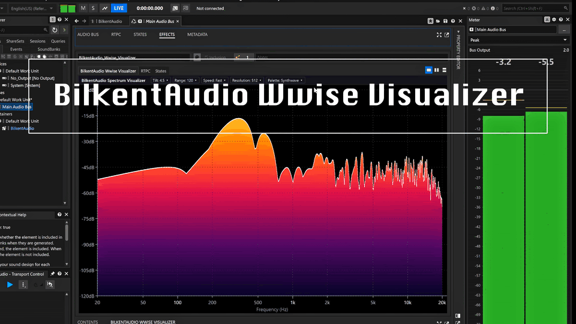

<p align="center">
  
</p>

# BilkentAudio Wwise Visualizer

[](https://www.audiokinetic.com/en/wwise/)


A real-time spectrum visualizer for Wwise Authoring.

BilkentAudio Wwise Visualizer gives you immediate, visually clear frequency information about your game's audio, right inside Wwise. It is designed to be accurate and reactive, so you can see what is happening in a mix as it plays, with enough customization options to suit individual preferences and team workflows.

> **Authoring only.** This plugin is a monitoring tool for use inside Wwise Authoring. It is not intended to be shipped in game builds. See [Best practices](#best-practices).

---

# Features

- **Real-time spectrum display** with a logarithmic frequency axis (20 Hz – 20 kHz) and dB scale
- **Accurate levels**: window-compensated magnitudes, so a sine wave reads its true peak level
- **Customizable display**, configured from the header strip above the spectrum:

| Setting | Options | Description |
|---|---|---|
| **Tilt** | 0, 3, 4.5 dB/oct | Tilts the display around 1 kHz for a more natural-looking balance. Use 0 for true levels. |
| **Range** | 60, 90, 120 dB | Vertical range of the display |
| **Speed** | Slow, Medium, Fast | How quickly the spectrum falls after a peak |
| **Resolution** | 512, 1024, 2048, 4096 | Frequency detail vs. responsiveness. Higher values resolve low frequencies better. |
| **Palette** | Synthwave, Ember, Aurora, Rainbow, Neutral | Colour scheme of the spectrum fill |

- **Settings saved with your project**, per effect instance or ShareSet, with undo/redo support
- **DPI-aware UI** that stays consistent across monitors and display scaling
- **Lightweight**: rendering stops entirely when no audio is playing

---

# Compatibility & Licensing

| **Wwise** | 2025.1.x |
|-----------|----------|
| **Platform** | Windows & macOS (Wwise Authoring) |

This repository exclusively provides builds for **Wwise 2025**, with support for future Wwise 2025.x releases provided as needed.

The **Wwise 2025 version of this plugin is free for both personal and commercial use**, regardless of studio size.

For **other Wwise versions (older or newer than 2025)**, or for inquiries regarding compatibility, custom builds, and ongoing support, please feel free to contact me at **[bilkentaudiodev@gmail.com](mailto:bilkentaudiodev@gmail.com)**.

---

# ☕ Support

If you find this project useful and have a little to spare, [please consider supporting my work on Ko-fi](https://ko-fi.com/bilkentaudio). It helps me continue developing, maintaining, and sharing tools like this with the community.

Thanks for the support! ❤️

---

# Installation

1. Download the latest build from the [**Releases**](../../releases/latest) page.
2. Unzip the downloaded archive.
3. **Close Wwise** if it is running.
4. Copy the plugin files (the `.dll` and its matching `.xml`) from the unzipped folder into the Plugins folder of your Wwise 2025 installation, for example:

   ```
   C:\Audiokinetic\Wwise2025.1.3.9039\Authoring\x64\Release\bin\Plugins (Windows)
   /Library/Application Support/Audiokinetic/Wwise 2025.1.3.9039/Authoring/x64/Release/bin/Plugins (macOS)
   ```

   The exact folder name depends on your installed Wwise version.
5. Start Wwise. The visualizer appears in the **Effects** list when adding an effect.

To update, close Wwise and replace both files with the ones from the newer release.

---

# Usage

1. Select a **bus** in the Master-Mixer Hierarchy.
2. In the bus's **Effects** tab, insert **BilkentAudio Wwise Visualizer**.
3. Open the effect's editor and play audio through the bus.
4. Use the header strip to adjust the display settings. If the panel is too narrow to show every setting, the remaining ones are available under **»**.

---

# Best practices

### Insert on busses

The visualizer is designed to be inserted on **busses**, and this is strongly recommended. A bus carries the actual mixed, post-fader signal, so what you see matches what you hear.

### Avoid inserting on containers

Inserting the visualizer on containers (Property Containers, Blend, Random, Switch containers, etc.) is **not recommended**. On containers, effects are processed per voice and **before** voice volume is applied, so:

- volume faders, low and high-pass filters being applied on those objects **are not** be reflected in the display
- the display shows a pre-fader signal, which can easily be misread

To meter a specific container, route it to its own bus and insert the visualizer there.

### Authoring only: do not ship it in game builds

These binaries are for **Wwise Authoring only**. The visualizer is a monitoring tool and is not intended to be part of your game.

If the effect is left on a bus when generating soundbanks, your game will still build and run, but the sound engine will report a warning that the plug-in ID was not found. **Bypass or remove the visualizer before generating soundbanks for your game builds.**

---

# Settings and version control

Visualizer settings are saved in your Wwise project's work units (`.wwu`), so changing them modifies the project and is shared through version control like any other Wwise change.

To keep these changes separate from your mix data, use a **visualizer ShareSet stored in its own work unit** (for example `ShareSets/Effects/Visualizer.wwu`) instead of custom effect instances. Setting changes then only touch that one file.

**Keeping settings local (optional):** commit the visualizer work unit once so that references from busses resolve for everyone, then:

- **Git:** run `git update-index --skip-worktree path/to/Visualizer.wwu` in your clone. Local changes to that file are no longer committed.
- **Perforce:** exclude the file from your workspace view (keep a local copy before syncing), or simply don't submit changes to it.

---

# Author

Built by Bilkent Samsurya<br> 

Audio Programmer | AI-integrated Audio Tools | Wwise & Unreal Specialist

[Website](https://bilkentsam.com) •
[LinkedIn](https://www.linkedin.com/in/bilkentsamsurya) •
[Twitter/X](https://twitter.com/BilkentAudio)

---

# Feedback/Questions

Feel free to reach out to me at bilkentaudiodev@gmail.com
